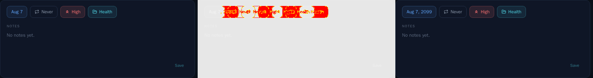

# ALF-303: the due date badge shows the year when it isn't this year

*2026-11-20T02:59:34.832Z*

Before this change every badge read a bare `Mon D`, so a task due Mar 4 next year looked the same as one due Mar 4 this year. Now a due date outside the current year gets its year: `Mar 4, 2027`. A date inside the current year still reads `Jan 15`. Today / Tomorrow / Yesterday stay relative, including across New Year (Dec 31 → `Tomorrow` for Jan 1).

The `Tasks/DueDateChip › AcrossYears` story, captured on 2026-11-20. Top row: last year (red, overdue), this year (no year), next year (blue). Bottom row: a timed next-year chip (`Mar 4, 2027 3 PM`) and the detail panel's larger chip, which uses the same label.

Two committed Storybook baselines moved, both because their fixtures sit in 2099. Each diff below is baseline | changed pixels | new. First, the detail panel: the chip now reads `Aug 7, 2099`.

Second, the mobile task cards: `Jul 9, 2099` and `Jul 12, 2099`. On a narrow card the longer badge pushes the `0/1` subtask counter onto its own line. That only happens for other-year dates, and it is the cost of showing the year.

Relative labels still win across New Year. This is the `Tasks/DueDateChip › AroundToday` story (yesterday / tomorrow / the day after, worked out from now), shot with Playwright's `page.clock.setFixedTime` pinned to Dec 31, 2026 at noon. Dec 30 reads `Yesterday`. Jan 1, 2027 reads `Tomorrow`, with no year. Jan 2, 2027 is the first label to carry its year.

A repeat rule's end date follows the same rule. It is never relative, but an end date outside the current year carries its year. Here are the two `Atoms/RecurrenceChip` snapshot baselines. First, `WithEndDate` (this year's Aug 1) reads `Daily until Aug 1`:

Second, the new `WithEndDateOtherYear` (2099) reads `Daily until Aug 1, 2099`:

