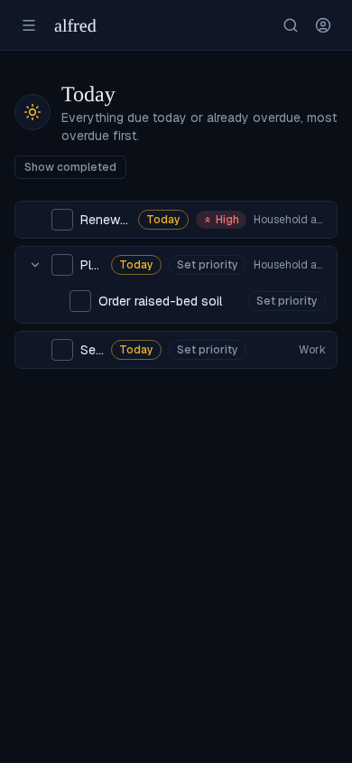
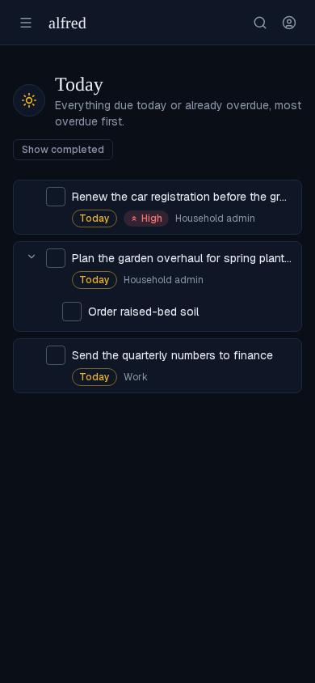
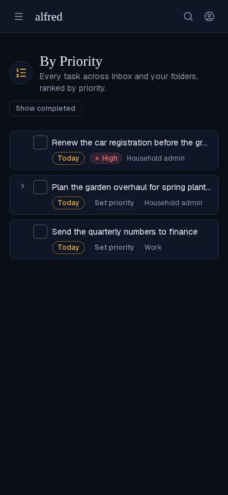
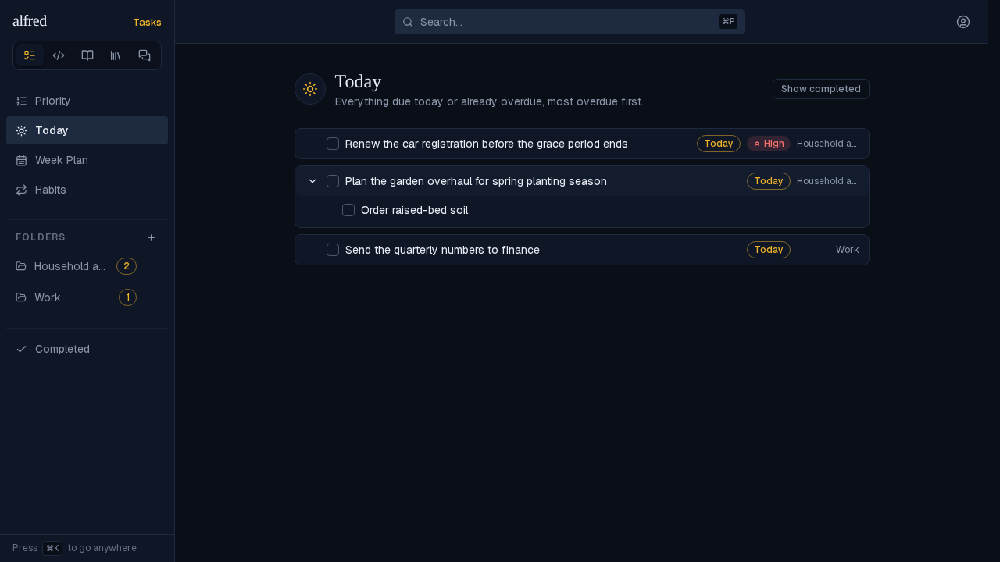

# ALF-349: Today drops the Set priority prompt and gives titles room on mobile

*2026-11-11T21:11:45.037Z*

Today and By Priority render the same triage row. Before this change every unprioritised row on Today carried a muted **Set priority** chip. On a 390px phone that chip, the due chip and the 80px folder label shared the title's line, so titles shrank to a few characters ("Renew…", "Pl…", "Se…"). Before, at 390px:

After, at 390px: Today shows no **Set priority** prompt on any row, subtasks included. A level that is already set (High) still shows, so a same-day tie stays legible. Below `md` the due chip, priority chip and folder label move to their own line under the title, so the title gets the row's full width.

By Priority keeps its **Set priority** prompt, because assigning a level is the point of that view. It gets the same two-line mobile layout.

Desktop (`md` and up) keeps the single-line row, without the prompt on Today:

