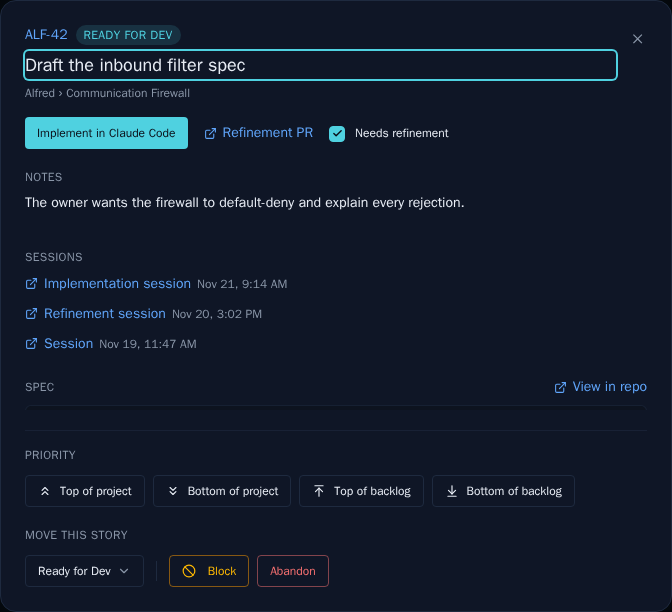

# ALF-359 — a session's link reaches its ticket on the first prompt

*2026-11-21T17:33:35.044Z*

Every alfred cloud session now records itself against its ticket on its **first prompt** (a new UserPromptSubmit hook), and the story detail lists every recorded session, newest first, each opening `claude.ai/code/<session id>`.

## The hook: the first prompt's write

Session start leaves a state file; the first prompt after it prints (under `--dry-run`) the body it would POST — the prompt, the skills it names resolved at the start commit (shown here as resolved/unresolved, since a blob sha moves with the skill), and the leading ref. Run in a scratch `TMPDIR` so it touches no real state.

```bash
export TMPDIR=$(mktemp -d) CLAUDE_CODE_REMOTE_SESSION_ID=cse_01Demo
HOOK=tools/session-ledger/src/hook/cli.ts
node $HOOK session-start --dry-run < /dev/null > /dev/null
PROMPT="ALF-359: Log the session URL back to the ticket\n\nYou are implementing the ticket ALF-359. Implement the merged spec. Follow .claude/skills/implement-spec/SKILL.md and .claude/skills/no-such-skill/SKILL.md."
printf "{\"prompt\":\"%s\"}" "$PROMPT" | node $HOOK prompt --dry-run \
  | node -e "const b=JSON.parse(require(\"fs\").readFileSync(0,\"utf8\"));b.skills=b.skills.map(s=>({path:s.path,resolved:s.blob_sha!==null}));console.log(JSON.stringify(b,null,2))"
```

```output
{
  "event": "prompt",
  "session_id": "session_01Demo",
  "repo": "ac3charland/alfred",
  "prompt": "ALF-359: Log the session URL back to the ticket\n\nYou are implementing the ticket ALF-359. Implement the merged spec. Follow .claude/skills/implement-spec/SKILL.md and .claude/skills/no-such-skill/SKILL.md.",
  "skills": [
    {
      "path": ".claude/skills/implement-spec/SKILL.md",
      "resolved": true
    },
    {
      "path": ".claude/skills/no-such-skill/SKILL.md",
      "resolved": false
    }
  ],
  "ref": "ALF-359",
  "warnings": []
}
```

Only the **first** prompt after a recorded start writes: a second prompt claims nothing (a `.prompted` marker sits beside the state file), and a prompt with no start state (a resumed container) sends nothing, so a later "ok, go ahead" can never become the frozen launch prompt. Both print nothing and exit 0 — UserPromptSubmit stdout would land in the model's context.

```bash
export TMPDIR=$(mktemp -d) CLAUDE_CODE_REMOTE_SESSION_ID=cse_01Demo
HOOK=tools/session-ledger/src/hook/cli.ts
node $HOOK session-start --dry-run < /dev/null > /dev/null
echo "{\"prompt\":\"ALF-359: first\"}" | node $HOOK prompt --dry-run > /dev/null
echo "second prompt: [$(echo "{\"prompt\":\"ok, go ahead\"}" | node $HOOK prompt --dry-run)] exit $?"
ls $TMPDIR/alfred-session-ledger
export TMPDIR=$(mktemp -d)
echo "no start state: [$(echo "{\"prompt\":\"ALF-359: first\"}" | node $HOOK prompt --dry-run)] exit $?"
```

```output
second prompt: [] exit 0
session_01Demo.json
session_01Demo.prompted
no start state: [] exit 0
```

## The lane label

The record route labels any write carrying a prompt with the launch lane that prompt reads as. The guard against prompt-copy drift is a round-trip of every real launch builder through `laneOfPrompt`:

```bash
npm run test -w frontend -- lib/code/launch-lane.test.ts --verbose --reporters=default 2>&1 | grep -E "✓|✕|Tests:" | sed -E "s/ \([0-9]+ ms\)//"
```

```output
    ✓ reads refinement from its builder’s prompt
    ✓ reads spike from its builder’s prompt
    ✓ reads bug from its builder’s prompt
    ✓ reads implementation from its builder’s prompt
    ✓ reads bypass from its builder’s prompt
    ✓ reads epic-refinement from its builder’s prompt
    ✓ reads epic-implementation from its builder’s prompt
    ✓ covers every lane
    ✓ reads a prompt pasted with CRLF line endings
    ✓ is null for an empty prompt
    ✓ is null for a one-paragraph prompt
    ✓ is null for a hand-written prompt
    ✓ is null for an opening sentence in the first paragraph
    ✓ is null for an opening sentence past the second paragraph
    ✓ labels refinement as Refinement session
    ✓ labels spike as Spike session
    ✓ labels bug as Bug-fix session
    ✓ labels implementation as Implementation session
    ✓ labels bypass as Skip-refinement session
    ✓ labels null as Session
    ✓ keeps a known lane and drops anything else to null
Tests:       21 passed, 21 total
```

## The story detail's Sessions section

Between Notes and Spec, newest first, each row labelled by lane with its local start time and opening the session on claude.ai in a new tab. A session whose lane can't be read is plain "Session". These are the new Storybook visual baselines (the store seeded as the shell layout seeds it from `code_sessions`):



One session, just launched:


The phone sheet:


With no sessions the section is absent — the existing `ReadyForDev` baseline is unchanged by this branch. A session recorded while the detail is open arrives over the new `code_sessions` realtime channel (pinned by the code-store tests), and the Playwright spec `lists the story’s recorded sessions…` asserts the links and hrefs end to end, excluding the same ref from another repo and the epic's own session.
