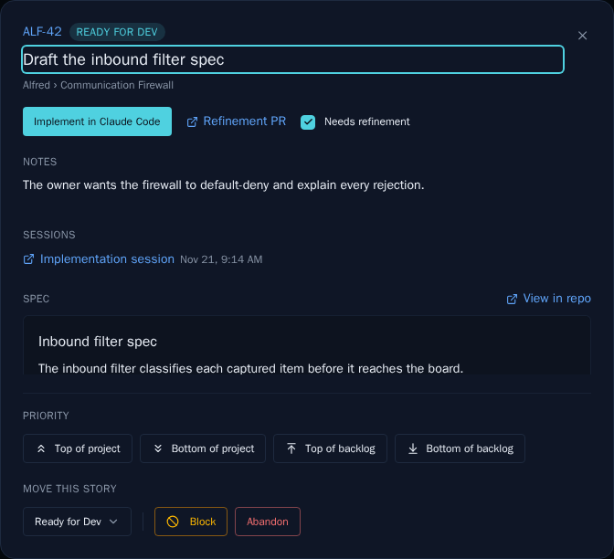
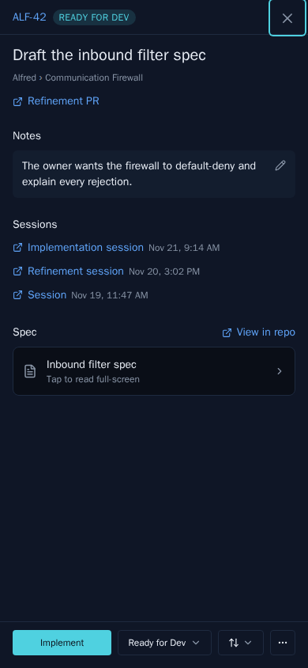
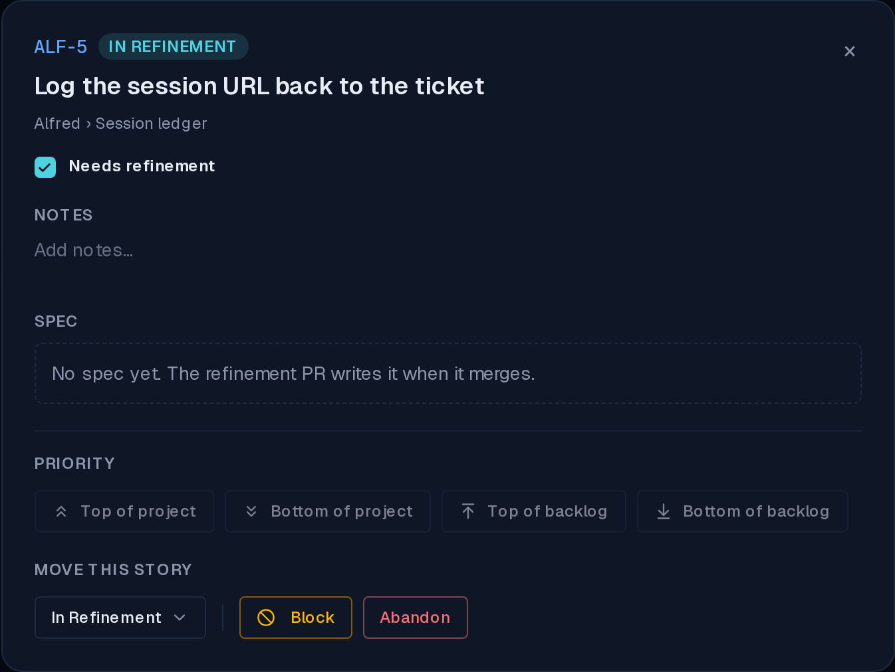
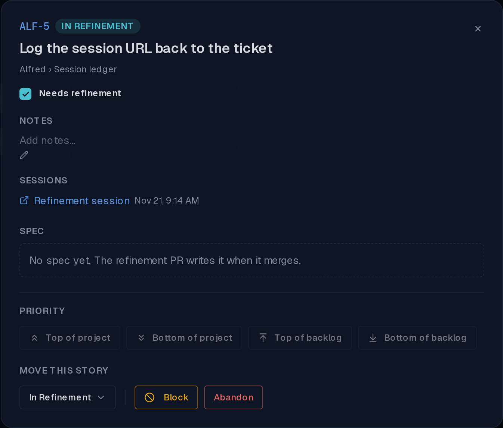

# ALF-359 — a session's link reaches its ticket on the first prompt

*2026-11-21T17:33:35.044Z*

Every alfred cloud session now records itself against its ticket on its **first prompt** (a new UserPromptSubmit hook), and the story detail lists every recorded session, newest first, each opening `claude.ai/code/<session id>`.

## The hook: the first prompt's write

Session start leaves a state file; the first prompt after it prints (under `--dry-run`) the body it would POST — the prompt, the skills it names resolved at the start commit (shown here as resolved/unresolved, since a blob sha moves with the skill), and the leading ref. Run in a scratch `TMPDIR` so it touches no real state.

```bash
export TMPDIR=$(mktemp -d) CLAUDE_CODE_REMOTE_SESSION_ID=cse_01Demo
HOOK=tools/session-ledger/src/hook/cli.ts
node $HOOK session-start --dry-run < /dev/null > /dev/null
PROMPT="ALF-359: Log the session URL back to the ticket\n\nYou are implementing the ticket ALF-359. Implement the merged spec. Follow .claude/skills/implement-spec/SKILL.md and .claude/skills/no-such-skill/SKILL.md."
printf "{\"prompt\":\"%s\"}" "$PROMPT" | node $HOOK prompt --dry-run \
  | node -e "const b=JSON.parse(require(\"fs\").readFileSync(0,\"utf8\"));b.skills=b.skills.map(s=>({path:s.path,resolved:s.blob_sha!==null}));console.log(JSON.stringify(b,null,2))"
```

```output
{
  "event": "prompt",
  "session_id": "session_01Demo",
  "repo": "ac3charland/alfred",
  "prompt": "ALF-359: Log the session URL back to the ticket\n\nYou are implementing the ticket ALF-359. Implement the merged spec. Follow .claude/skills/implement-spec/SKILL.md and .claude/skills/no-such-skill/SKILL.md.",
  "skills": [
    {
      "path": ".claude/skills/implement-spec/SKILL.md",
      "resolved": true
    },
    {
      "path": ".claude/skills/no-such-skill/SKILL.md",
      "resolved": false
    }
  ],
  "ref": "ALF-359",
  "warnings": []
}
```

Only the **first** prompt after a recorded start writes: a second prompt claims nothing (a `.prompted` marker sits beside the state file), and a prompt with no start state (a resumed container) sends nothing, so a later "ok, go ahead" can never become the frozen launch prompt. Both print nothing and exit 0 — UserPromptSubmit stdout would land in the model's context.

```bash
export TMPDIR=$(mktemp -d) CLAUDE_CODE_REMOTE_SESSION_ID=cse_01Demo
HOOK=tools/session-ledger/src/hook/cli.ts
node $HOOK session-start --dry-run < /dev/null > /dev/null
echo "{\"prompt\":\"ALF-359: first\"}" | node $HOOK prompt --dry-run > /dev/null
echo "second prompt: [$(echo "{\"prompt\":\"ok, go ahead\"}" | node $HOOK prompt --dry-run)] exit $?"
ls $TMPDIR/alfred-session-ledger
export TMPDIR=$(mktemp -d)
echo "no start state: [$(echo "{\"prompt\":\"ALF-359: first\"}" | node $HOOK prompt --dry-run)] exit $?"
```

```output
second prompt: [] exit 0
session_01Demo.json
session_01Demo.prompted
no start state: [] exit 0
```

## The story detail's Sessions section

Between Notes and Spec, newest first, each row labelled by lane with its local start time and opening the session on claude.ai in a new tab. A session whose lane can't be read is plain "Session". These are the new Storybook visual baselines (the store seeded as the shell layout seeds it from `code_sessions`):


One session, just launched:



The phone sheet:



## The whole journey, in the real app

`with-app.sh` builds and boots the real Next app against the E2E suite's in-memory Supabase mock, then `journey.mjs` does the following:

1. Opens ALF-5 with no sessions recorded.
2. POSTs a session start and the hook's first-prompt write to the real record route, using a refinement launch prompt. The route adds the launch lane it reads from the prompt.
3. Sends the first stop, which carries a later message and another ref.
4. Re-runs a backfill with no lane.
5. Reopens ALF-5.

The same ref recorded in another repo, and the epic's own session, are seeded beside it and must not show. The mock mirrors the RPCs' column ownership (the real SQL is pinned by the database integration suite). It has no realtime socket, so step 5 reopens the page. A session arriving live on an open detail over the new `code_sessions` channel is pinned by the code-store tests instead.

```bash
docs/demos/ALF-359-session-links/with-app.sh /tmp/alf-359-shots
```

```output
before.png: sections ["Notes","Spec","Priority","Move this story"]; session links []
after the first-prompt write:
{
  "session_id": "session_01DemoRefine",
  "ref": "ALF-5",
  "launch_lane": "refinement",
  "prompt_source": "recorded",
  "prompt": "ALF-5: Log the session URL back to the ticket\n\nYou are refining the ticket ALF-5. Produce a SPEC ONLY — describe the concrete change."
}
after the first stop:
{
  "session_id": "session_01DemoRefine",
  "ref": "ALF-5",
  "launch_lane": "refinement",
  "prompt_source": "recorded",
  "prompt": "ALF-5: Log the session URL back to the ticket\n\nYou are refining the ticket ALF-5. Produce a SPEC ONLY — describe the concrete change."
}
after a backfill re-run with no lane:
{
  "session_id": "session_01DemoRefine",
  "ref": "ALF-5",
  "launch_lane": "refinement",
  "prompt_source": "recorded",
  "prompt": "ALF-5: Log the session URL back to the ticket\n\nYou are refining the ticket ALF-5. Produce a SPEC ONLY — describe the concrete change."
}
after.png: sections ["Notes","Sessions","Spec","Priority","Move this story"]; session links ["Refinement session Nov 21, 9:14 AM → https://claude.ai/code/session_01DemoRefine"]
```

Before: ALF-5 open with nothing recorded. No Sessions section.



After: one link, labelled by the lane the route read from the prompt, with its local start time, opening `claude.ai/code/session_01DemoRefine`. Neither the other repo's ALF-5 session nor the epic's session appears.


