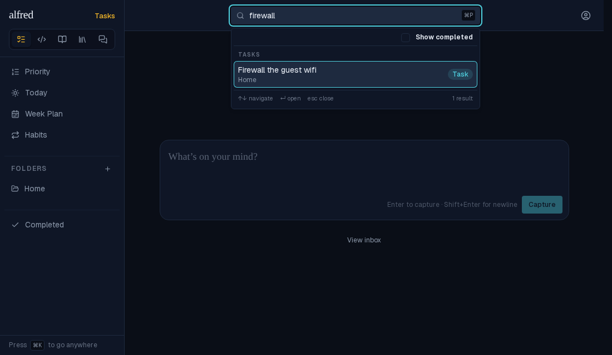
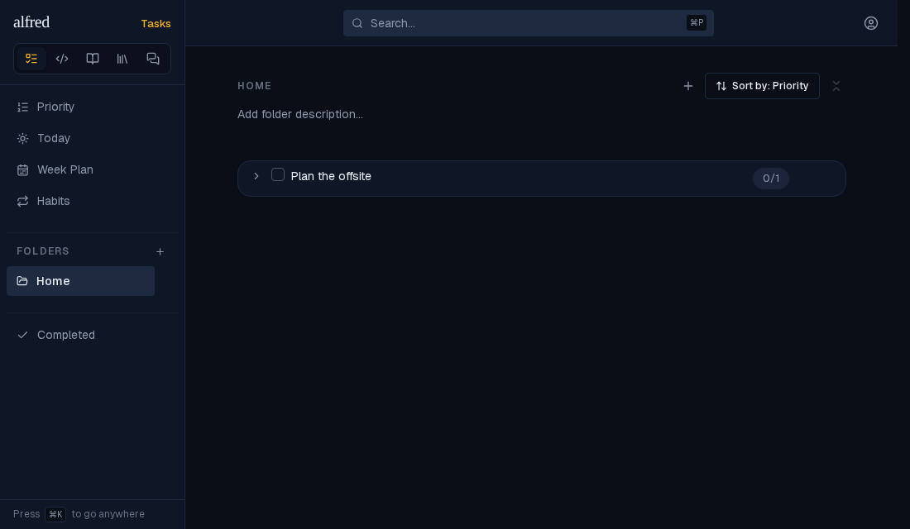
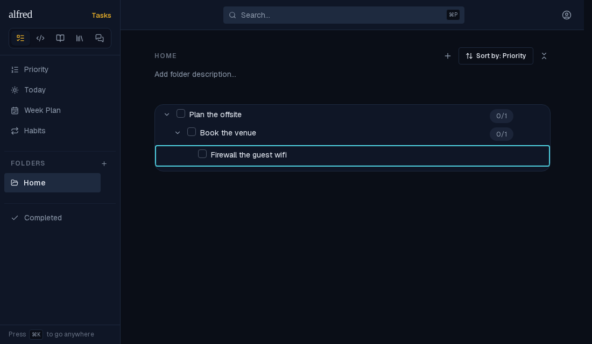
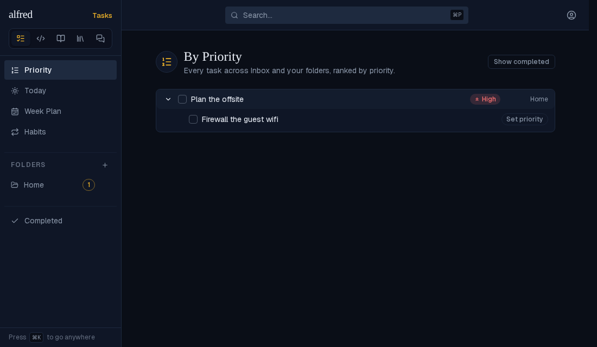
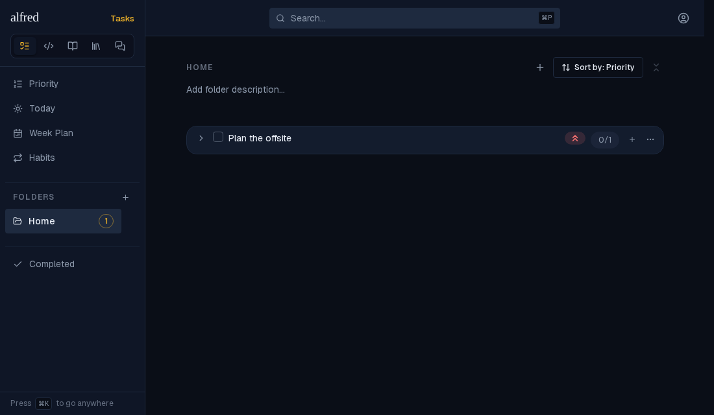
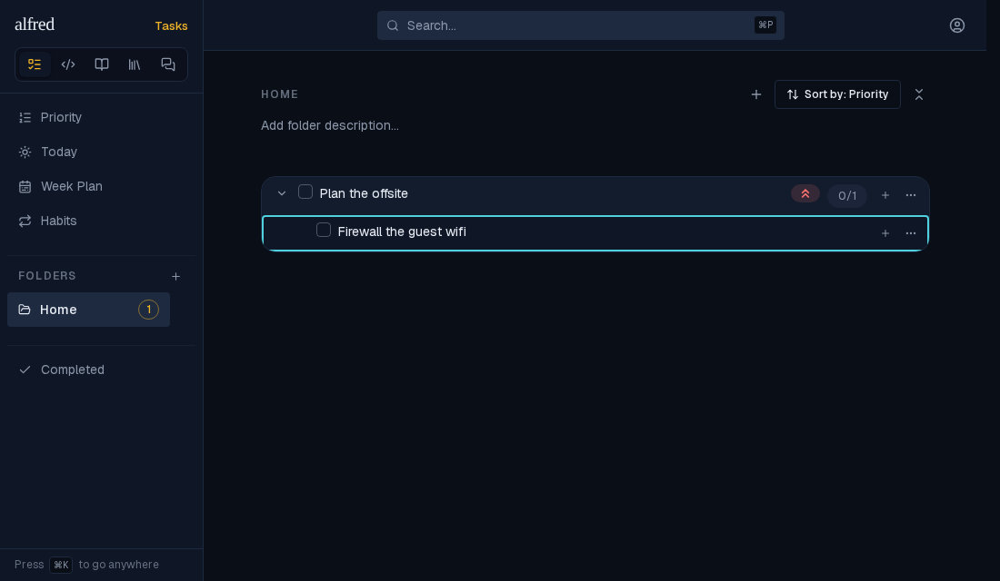
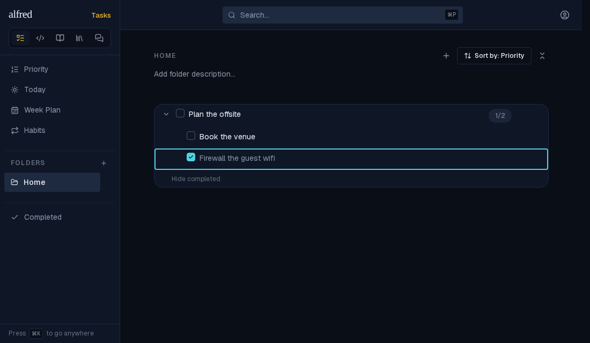
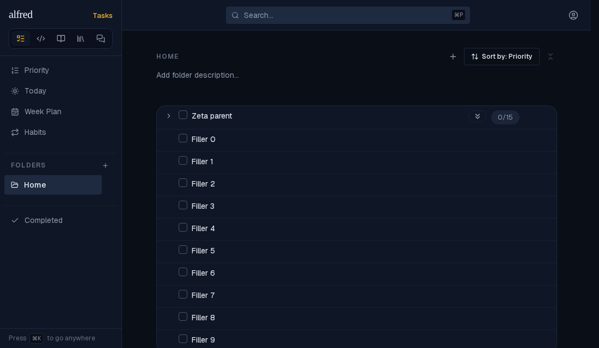
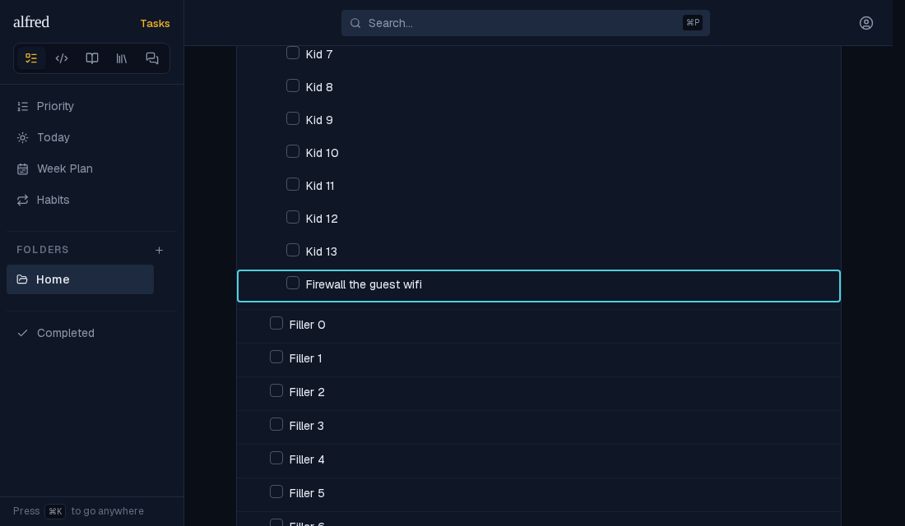

# Jumping to a subtask opens its parents and rings it (ALF-361)

*2026-11-20T02:51:37.027Z*

**Bug:** jumping to a subtask (global search, or a nested row in By Priority) switched to the right folder, but the subtask's ancestors stayed collapsed, so its row (and the teal 'you are here' ring) was hidden inside a 0-height, aria-hidden subtask list. **Fix:** a shared `useNavigateToTask` hook opens every ancestor's subtask tree in the layout-level expansion store before the jump. Shots were captured through the Playwright mock-backend harness against the live app; 'before' frames were taken with the two call-site changes reverted.

## Journey 1: global search, two levels deep

Seed: folder **Home** › *Plan the offsite* › *Book the venue* › **Firewall the guest wifi**. Search for 'firewall':

**Before** (press Enter): the jump lands on Home with *Plan the offsite* collapsed. The subtask and its ring can't be seen.

**After:** both ancestors open and the subtask row is ringed.

## Journey 2: By Priority → a nested row

Same bug, same cause: a By-Priority subtask's link jumps into its folder. Expand *Plan the offsite* in By Priority, then click the subtask:

**Before:** the folder shows the parent collapsed.

**After:** the parent is open and the subtask is ringed.

## Journey 3: a completed subtask (from review)

A completed child of an active task sits behind its parent's *Show completed* panel. With *Show completed* ticked in search, selecting it now opens the parent **and** that panel, and rings the row.

## Journey 4: the folder is already open and the target expands past the fold (from review)

*Zeta parent* has 15 collapsed subtasks. Searching for the last one from this folder used to scroll before the expand finished: the row measured at the parent's position, then the expand pushed it off-screen (viewport ratio 0, pinned in `e2e/global-search.spec.ts`). Now the row scrolls again once the ancestor's expand transition ends.

After Enter: the subtask is centred and ringed.

