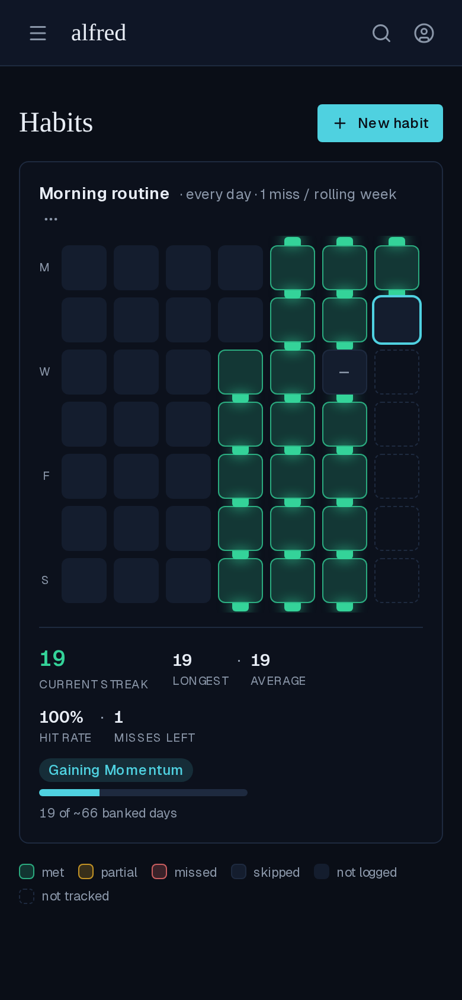
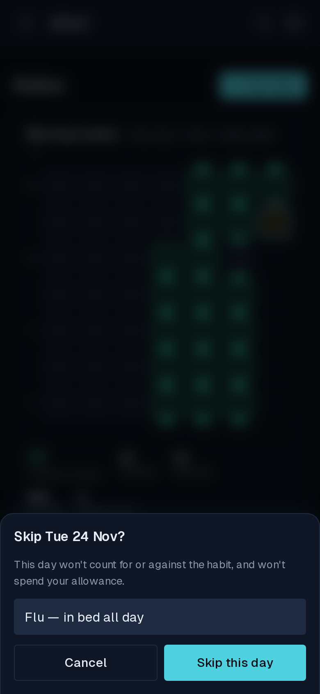

# ALF-370: Mobile-friendly habit entry

*2026-11-24T20:17:54.237Z*

On a phone (390×844, touch), the habit grid's day squares grow from 26px to 38px on a 44px pitch, and tapping a day opens the day editor as a bottom sheet with 44px controls instead of the desktop popover. Desktop is unchanged. Every shot below is the live app (Next + the in-memory Supabase mock), driven by touch in Playwright.

**1. The phone view of /habits.** Thumb-sized squares; the strip still opens on the newest week (today's teal ring at the right edge), older weeks a sideways scroll away; connectors still join days across the gap and the Sunday→Monday stubs still show.

**2. Tapping today's square opens the bottom sheet**, named "{date} — Morning routine". The header shows the date, the habit name, and the derived verdict (Missed: nothing recorded). Focus goes to the sheet, not a field, so no keyboard rises uninvited.

**3. Logging in the sheet.** A time typed, one yes/no answered Yes and one answered No (two buttons, not the cycling box), the duration left empty. The verdict re-derives to Partial and the cost line follows. Every control is 44px tall.

**4. Done closes the sheet; the square has repainted** (amber partial, top right) and focus is back on it.

**5. The skip step inside the sheet** (⋯ → Mark as skipped…): a full-width reason field, Cancel and Skip this day sharing the width at 44px. Skip this day stays disabled until a reason is typed.

**6. A skipped day** shows its reason in place of the criteria, then the cost line, ⋯ and Done.

