# ALF-370: Mobile-friendly habit entry

*2026-11-24T20:46:58.405Z*

On a touch device (a viewport under 768px, or a coarse pointer at any width) the habit grid's squares grow from 26px to 38px on a 44px pitch, and tapping a day opens the day editor as a bottom sheet with 44px controls in place of the desktop popover. Every shot is the live app (Next + the in-memory Supabase mock) driven by touch in Playwright at 390×844, unless noted.

## The grid

**The phone view of /habits.** Thumb-sized squares. The strip opens on the newest week, with today's teal ring at the right edge. Connectors still join days across the gap, and the Sunday→Monday stubs still show.

**Older weeks are a sideways scroll away**, with the weekday labels fixed outside the strip.

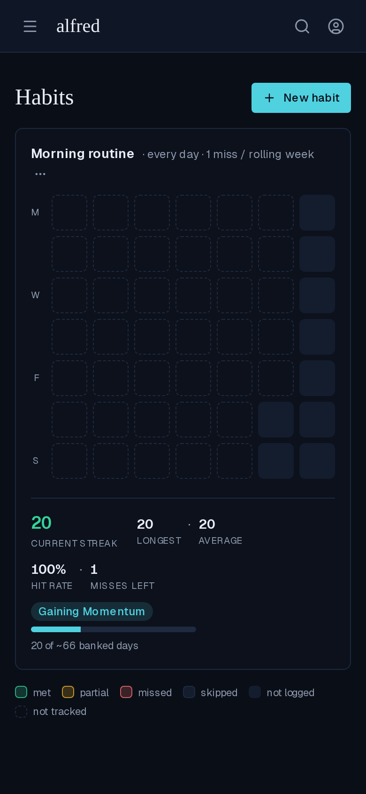

**A tap in the gap opens the nearest day.** The magenta dot marks a tap 2px below last Monday's square, inside the 6px gap. Each button's hit area reaches 3px past its square, so neighbouring targets meet.

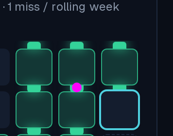

The tap opens **last Monday**, not nothing. The sheet is named "{date} — {habit}".

## Logging a day

**Today's sheet on opening.** The header shows the date, the habit name and the derived verdict: Missed, since nothing is recorded yet. The cost line reads *Spends this week's allowance*. Focus goes to the sheet, not a field, so no keyboard rises uninvited.

**Everything recorded:** a time, Yes on both yes/no criteria (two buttons, not the desktop's cycling box) and a duration. The verdict re-derives to Met and the cost line follows to *Earned — costs nothing*.

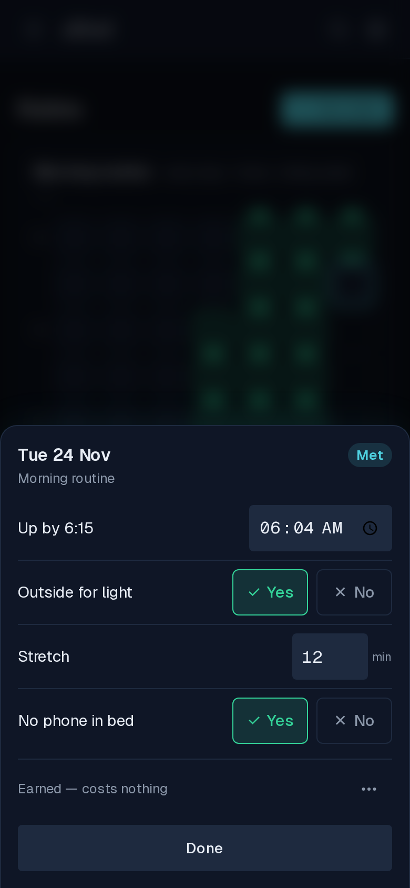

**A slip: No tapped on "No phone in bed".** It lights red, and the verdict drops to Partial.

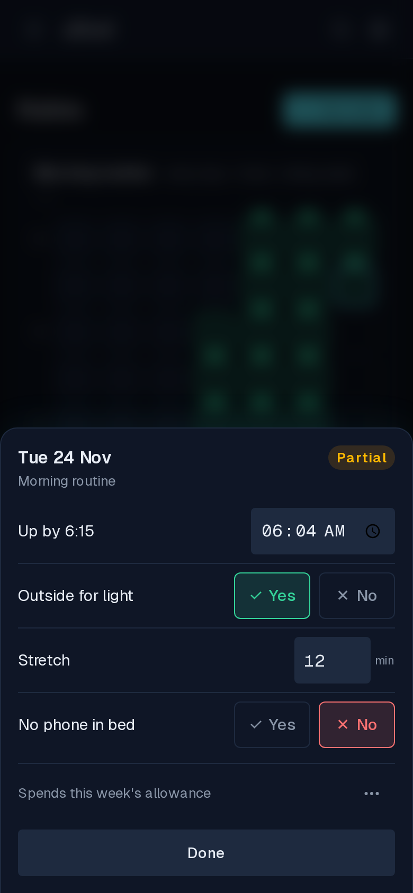

**Tapping the lit No again clears the criterion.** Both halves go grey and the cost line returns to *Spends this week's allowance*. Unrecorded and recorded-as-no are different days.

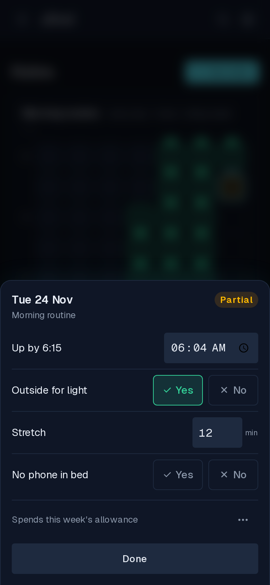

Yes is tapped back on, then **Done**. The sheet closes, today's square repaints to met, and focus returns to it (teal ring).

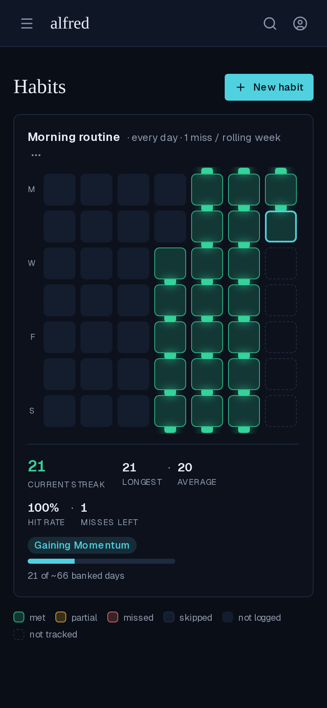

## Skipping a day

**Yesterday's sheet → ⋯.** The menu's *Mark as skipped…* item is a 44px row.

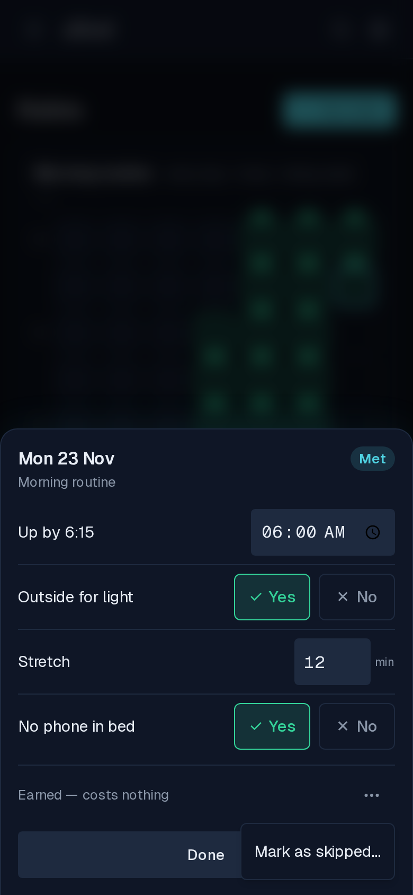

**The skip step**, titled with the date and the habit's name. *Skip this day* is disabled until a reason is typed.

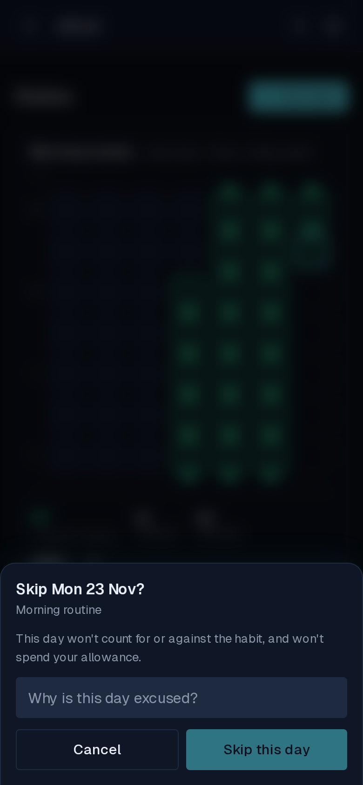

**A reason typed:** *Skip this day* is enabled. Cancel and Skip share the width at 44px.

**Skip this day** closes the sheet, and yesterday's square (top right) repaints as skipped: the neutral plate with a dash.

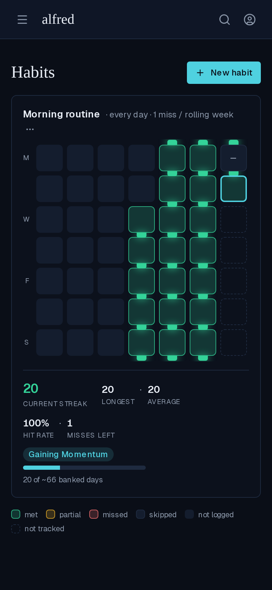

**Reopened, the skipped day** shows its reason in place of the criteria, then the cost line, ⋯ and Done.

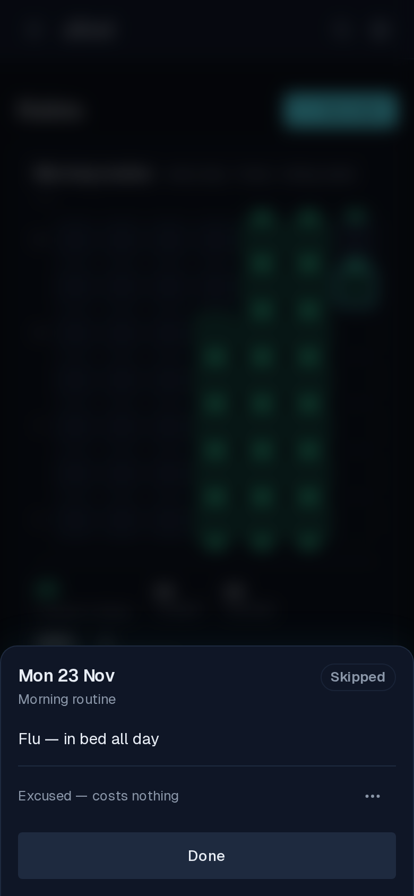

## Opening and closing

**The sheet fades in, and fades out whole.** It is closed first by a tap on the overlay above it, then reopened and closed with Done. The editor stays drawn through the exit fade, and its values are saved the moment it closes. Escape also closes it; that path is covered by the unit tests, since a phone has no Escape key.

## Other widths

**A tablet (1024×768, touch):** the coarse pointer alone switches touch mode on. The sheet is capped at 28rem and centred.

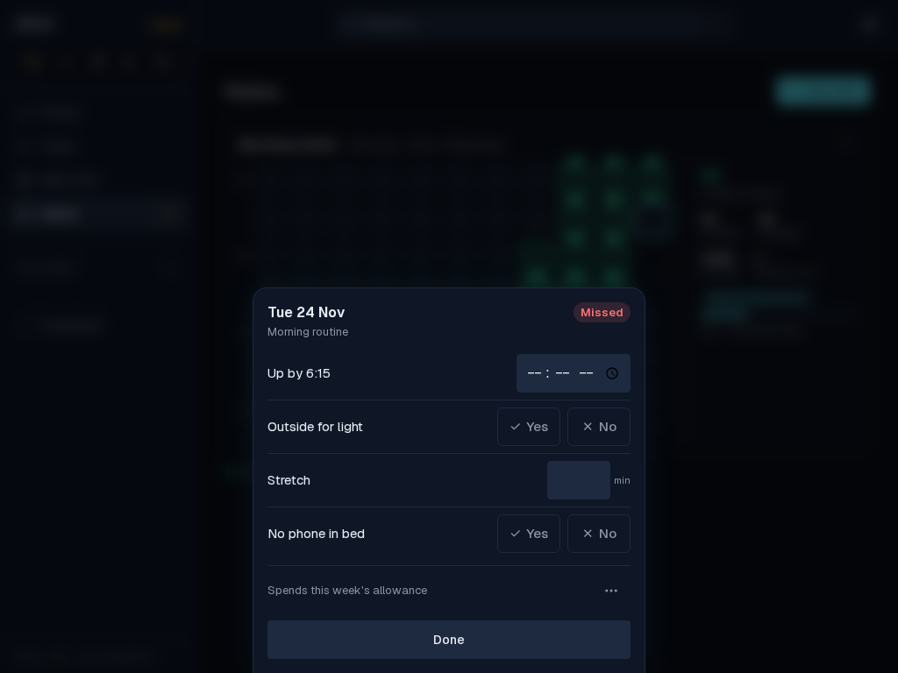

**Desktop (1280×800, mouse) is unchanged:** 26px squares and the dense popover editor with its cycling yes/no boxes.

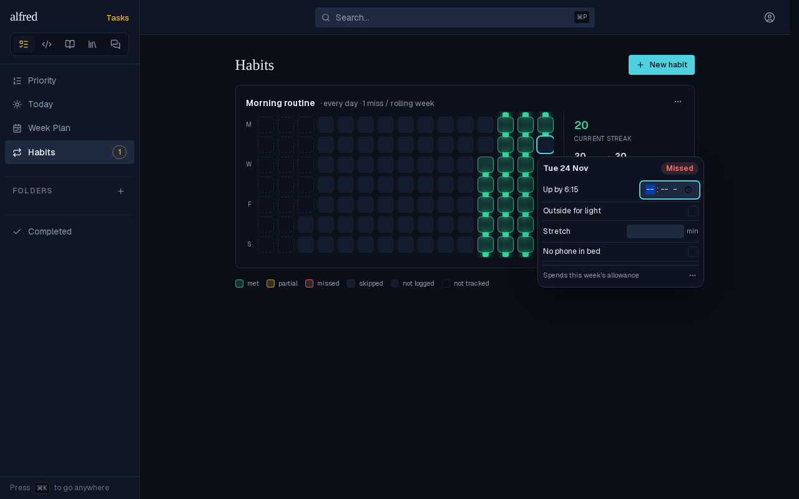

## Storybook baseline moved by review

After review, the skip step names the habit under its title, as the spec's plate draws it. Shown as the touch skip-step baseline's diff: before | changed pixels | after.

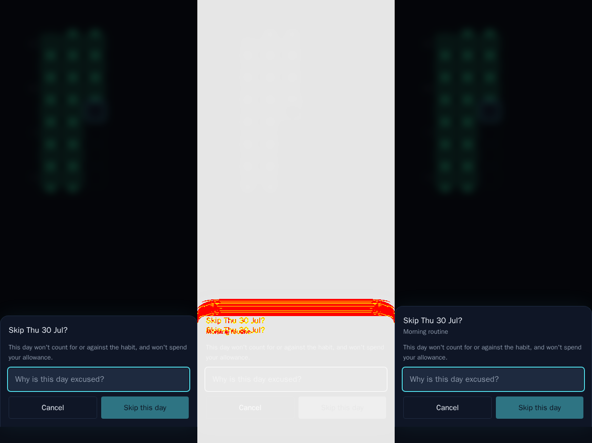
