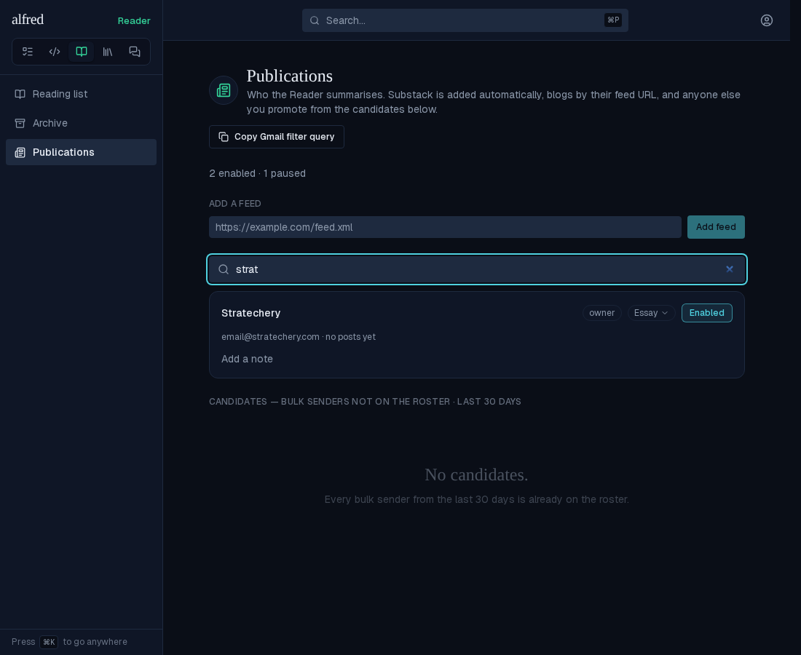

# Reader: search the publications roster

*2026-11-20T03:11:47.323Z*

ALF-358 adds a search box over the publications roster at /reader/publications. Typing filters the roster cards with a case-insensitive substring match on name, handle, domain, feed URL and note. The enabled/paused counts and the Gmail filter button still describe the whole roster, and the candidates are never filtered. The shots below come from the live app at the real route, driven by Playwright against the in-memory Supabase mock with three publications seeded.

**Before:** the full roster of three publications (one paused), with the new search box above the cards.


**Typing `strat`:** only Stratechery is left. The count line still reads 2 enabled · 1 paused.



**Typing `zebra`:** nothing matches, so the roster gives way to an empty state that names the query.


**Tests.** The matcher's unit tests and the view's search tests (filter, match on handle and feed URL, clear restores, no-match state, counts unchanged, candidates untouched, no box on an empty roster):

```bash
npm run -s test -w frontend -- components/reader/publications-search components/reader/publications-view -t 'matchesPublicationQuery|search' 2>&1 | grep -E '^Tests:'
```

```output
Tests:       35 skipped, 15 passed, 50 total
```

**Visual baselines.** The search box sits above the cards, so every Storybook baseline with a populated roster moves down by one field. Below is the Populated story's diff (baseline | changed pixels | new render); the other seven move the same way. A new `Searched` story pins the narrowed state.


