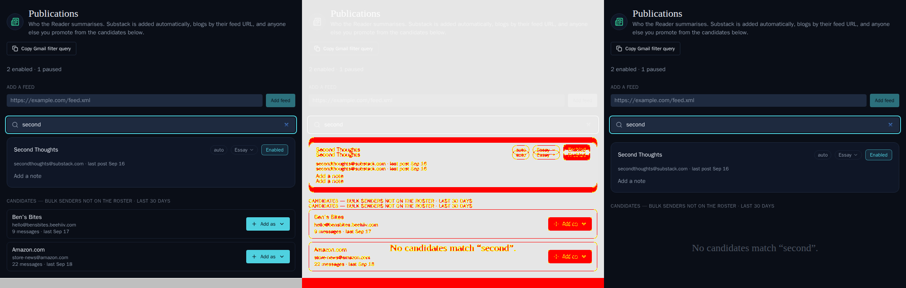

# Reader: search publications and candidates

*2026-11-20T03:49:27.057Z*

**What changed:** /reader/publications has a search box. Typing filters both lists on the page:
- **the roster**, matching a publication's name, handle, domain, feed URL or note
- **the candidates**, matching a sender's name or handle

The "2 enabled · 1 paused" line always counts the whole roster.

The three shots are the live page, seeded with three publications and two candidates.

### 1. Empty box: everything shows
Three publications, two candidates (Ben's Bites, Not Boring).


### 2. Query `substack`: both lists narrow
The roster keeps only Second Thoughts (secondthoughts@**substack**.com). The candidates keep only Not Boring (packy@notboring.**substack**.com). The count line is unchanged.


### 3. Query `zebra`: no match in either list
Each list says so and names the query.


### Tests
The search tests: the matchers for publications and candidates, plus the view tests. Those cover each list filtering, the no-match states, the counts staying whole, and the query clearing when a newly added feed joins the roster, so its card isn't hidden.

```bash
npm run -s test -w frontend -- components/reader/publications-search components/reader/publications-view -t 'matches|search' 2>&1 | grep -E '^Tests:'
```

```output
Tests:       35 skipped, 24 passed, 59 total
```

### Visual baseline
The `Searched` Storybook story, before and after this change: the candidates now give way to "No candidates match" (baseline | changed pixels | new render). The other publications baselines moved only because the search box pushes the cards down.


