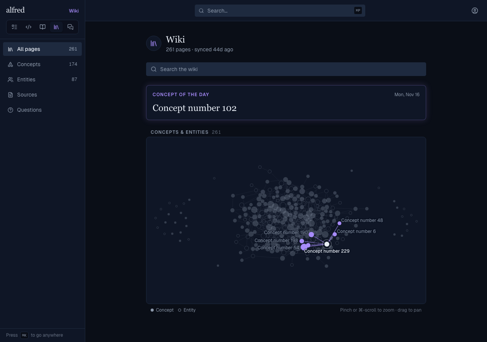

# ALF-364: the wiki web runs at full framerate with a few hundred pages

*2026-11-16T15:37:24.551Z*

The landing's web had dropped to about 20 frames a second now that the wiki holds 261 concepts and entities joined by 542 links. The physics wasn't the cost: script took about 1.5 ms of each frame and **style recalculation about 37 ms**.

The cause is one rule in Tailwind's preflight, `a { text-decoration: inherit }`. `text-decoration` doesn't inherit, and the browser answers an explicit `inherit` of such a property by restyling the element whenever its parent's style changes. Each node's link sits inside the element the stage moves every tick, so every tick restyled every link — and that cost grows with the square of the node count (half the nodes cost a quarter as much).

The fix is one class on the node's link, `[text-decoration:none]`, so the link no longer inherits the property. Nothing looks different: the links never had an underline.

## The web at the real wiki's size

The real app through the Playwright harness, against the in-memory Supabase mock, seeded with a generated wiki of the real one's size: 261 concepts and entities, 542 links.

## Before and after, in the same browser

Measured in headless Chromium on that 261-node web, over the frames of each step. *Before* is the same build with the one class taken off the links in the page, so both columns run the same code on the same machine. The CPU column is Chromium's CPU throttle: 4x stands in for a slower machine. Frames a second top out at the display's 120. These are timings from one run, so they aren't re-run by `verify`; the regression test below counts elements instead, which doesn't vary.

| Step | | CPU | Frames a second | 95th-percentile frame | Style per frame | Main thread per frame |
| --- | --- | --- | --- | --- | --- | --- |
| dragging a dot | after | 1x | 120 fps | 9 ms | 0.4 ms | 3.6 ms |
| dragging a dot | after | 4x | 76 fps | 18 ms | 1.1 ms | 13.0 ms |
| dragging a dot | before | 1x | 21 fps | 100 ms | 44.7 ms | 47.5 ms |
| dragging a dot | before | 4x | 6 fps | 383 ms | 153.1 ms | 166.5 ms |
| settling after the drag | after | 1x | 118 fps | 9 ms | 0.2 ms | 2.3 ms |
| settling after the drag | after | 4x | 82 fps | 17 ms | 1.1 ms | 13.1 ms |
| settling after the drag | before | 1x | 20 fps | 91 ms | 47.8 ms | 50.3 ms |
| settling after the drag | before | 4x | 7 fps | 517 ms | 137.9 ms | 152.2 ms |
| settling on open | after | 1x | 119 fps | 9 ms | 0.2 ms | 2.3 ms |
| settling on open | after | 4x | 72 fps | 18 ms | 1.1 ms | 13.9 ms |
| settling on open | before | 1x | 27 fps | 75 ms | 34.8 ms | 37.3 ms |
| settling on open | before | 4x | 9 fps | 191 ms | 104.5 ms | 116.9 ms |

## What keeps it fixed

`frontend/e2e/wiki-web-restyle.spec.ts` drags a dot on the 52-node sample web while Chromium traces, and reads how many elements each style pass restyled. A tick should restyle each node once: 52 nodes, 54 elements with the fix. Without it the median pass restyles 106 — every node and its link — and the test fails (`Expected: < 78, Received: 106`). It counts elements rather than milliseconds, so it gives the same answer on a slow CI machine.
