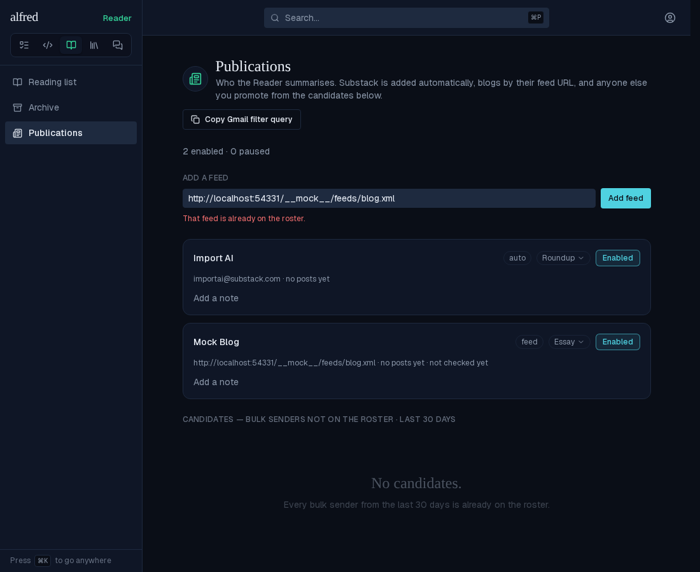

# Reader: import articles from RSS and Atom feeds (ALF-344)

*2026-11-09T16:48:11.205Z*

Paste a blog's feed URL on **/reader/publications** and it joins the roster as a card. The Worker's five-minute Reader tick then polls one due feed hourly and every new entry from the last seven days lands in the reading list, summarised with the feed's own summary kind like a newsletter.

**The parser on the real motivating feed.** `mlarson.org/feed.xml` turned out to be Atom 1.0 with full `content` and only an `updated` date. The script below runs the Worker's own parser and planner (`workers/src/reader/feeds.ts`) over the committed capture, as a poll on the capture day (2026-11-09). Only the entry inside the seven-day horizon is taken. None of the entries is an excerpt, so no entry page would be fetched. A re-poll once that post is stored takes nothing.

```bash
node docs/demos/reader-feeds/parse-mlarson.mjs
```

```output
feed: Mark Larson (author Mark Larson), 3 entries
- 2026, Week 45
    id https://mlarson.org/2026/11/08/2026-week-45/
    date 2026-11-08T08:11:17.000Z  excerpt? no — full content
- 2026, Week 44
    id https://mlarson.org/2026/11/01/2026-week-44/
    date 2026-11-01T11:11:26.000Z  excerpt? no — full content
- 2026, Week 43
    id https://mlarson.org/2026/10/25/2026-week-43/
    date 2026-10-25T08:10:41.000Z  excerpt? no — full content

poll at 2026-11-09T12:00:00.000Z, five slots free:
takes 2026, Week 45
drained: true (so the feed is stamped checked)
re-poll with that post stored takes: 0 entries
```

**Adding a feed: the live app** (Playwright against the in-memory Supabase mock, which serves a small Atom feed titled "Mock Blog" and an HTML homepage; the route's probe really fetches both from the Next server). First a homepage is pasted in. The route fetches it, finds no RSS or Atom root, and refuses it. The field keeps the text and says why on one line beneath it, and nothing is added.


Then the feed's own URL. Editing the field clears the refusal. Before pressing Enter:


After Enter, the card appears at its sorted place. It is named from the feed's title, wears a **feed** chip in place of the provenance, defaults to Essay and Enabled, and shows the feed URL and "not checked yet" where a sender shows its handle. The count line counts it; the field clears.


**A failing feed.** The Worker stamps a failed poll on the feed's own row. While the error is newer than the last success, the card shows the amber line, counted from the last success. The tick's own health, and the Reader header, are untouched.


**A feed post in the reading list.** It is an ordinary row: the eyebrow is the feed's card name (not the entry's author), the date is the entry's own publish date, and there is no "via" suffix.


**Moved Storybook baselines.** The Add-a-feed field sits above the roster on every publications story, and the heading's description changed, so six `Reader/PublicationsView` baselines moved (approved and committed). Below is the `Populated` diff: baseline | changed pixels | new. Four new baselines cover the feed states: `FeedAdded`, `NotAFeed`, `FeedFailing` and `Reader/PostRow` `FeedPost`.


The two other refusals: a URL that doesn't answer quotes its status, and a feed already on the roster says so. The duplicate check runs before any fetch, so it holds even while the blog is down.




**The Worker importing feeds, tick by tick.** This runs the production `runReaderTick` eight times against stand-ins. PostgREST is an in-memory roster and post table, and the blogs are canned responses: the mlarson.org capture, an excerpt-only feed with its entry page, and a feed that 404s and later recovers. Only the summariser is replaced; its input is printed instead of sent to the model. What it shows:
- one feed polled per tick, never-checked first;
- each new entry inserted as `source=feed` with its own date, then summarised with its feed's kind;
- an excerpt's page read for the article;
- the drained-poll stamp with its validators;
- a 404 stamped on the feed and retried hourly, never as a tick failure;
- an ETag re-poll that re-imports nothing;
- the recovery's success stamp, newer than the error, which clears the card's amber line.

```bash
node docs/demos/reader-feeds/tick-harness.mjs
```

```output

2026-11-09T12:00:00.000Z — three never-checked feeds: ONE is polled a tick, the lowest id first — it 404s
    GET https://dead.example/rss
    stamp Dead Blog: {"feed_checked_at":"2026-11-09T12:00:00.000Z","feed_last_error":"it answered 404","feed_last_error_at":"2026-11-09T12:00:00.000Z"}
    → feed: {"feedId":"pub-dead","status":"failed","taken":0,"failures":["it answered 404"]}; tick failures: []

2026-11-09T12:05:00.000Z — the next never-checked feed: mlarson.org's one entry inside seven days is imported
    GET https://mlarson.org/feed.xml
    insert reader_posts: source=feed feed=pub-mlarson entry=https://mlarson.org/2026/11/08/2026-week-45/ received_at=2026-11-08T08:11:17.000Z words=403
    summarise: kind=essay publication="mlarson.org" title="2026, Week 45" words=403
    stamp mlarson.org: {"feed_checked_at":"2026-11-09T12:05:00.000Z","feed_last_success_at":"2026-11-09T12:05:00.000Z","feed_etag":"\"m1\"","feed_last_modified":null}
    → feed: {"feedId":"pub-mlarson","status":"polled","taken":1,"failures":[]}; tick failures: []

2026-11-09T12:10:00.000Z — the excerpt-only feed: its entry page is read and its article stored
    GET https://quiet.example/feed.xml
    GET https://quiet.example/posts/cities
    insert reader_posts: source=feed feed=pub-quiet entry=https://quiet.example/posts/cities received_at=2026-11-08T07:00:00.000Z words=300
    summarise: kind=roundup publication="Quiet Cities" title="Cities are getting quieter" words=300
    stamp Quiet Cities: {"feed_checked_at":"2026-11-09T12:10:00.000Z","feed_last_success_at":"2026-11-09T12:10:00.000Z","feed_etag":null,"feed_last_modified":"Sun, 08 Nov 2026 07:00:00 GMT"}
    → feed: {"feedId":"pub-quiet","status":"polled","taken":1,"failures":[]}; tick failures: []

2026-11-09T12:15:00.000Z — every feed was checked within the hour: nothing is due
    → feed: {"skipped":"none due"}; tick failures: []

2026-11-09T13:15:00.000Z — an hour on: the dead blog is retried (hourly, not every tick) and still 404s
    GET https://dead.example/rss
    stamp Dead Blog: {"feed_checked_at":"2026-11-09T13:15:00.000Z","feed_last_error":"it answered 404","feed_last_error_at":"2026-11-09T13:15:00.000Z"}
    → feed: {"feedId":"pub-dead","status":"failed","taken":0,"failures":["it answered 404"]}; tick failures: []

2026-11-09T13:20:00.000Z — mlarson.org re-polled with its ETag: its entry is already a post, so nothing is taken
    GET https://mlarson.org/feed.xml (If-None-Match "m1")
    stamp mlarson.org: {"feed_checked_at":"2026-11-09T13:20:00.000Z","feed_last_success_at":"2026-11-09T13:20:00.000Z","feed_etag":"\"m1\"","feed_last_modified":null}
    → feed: {"feedId":"pub-mlarson","status":"polled","taken":0,"failures":[]}; tick failures: []

2026-11-09T13:25:00.000Z — Quiet Cities re-polled: nothing new
    GET https://quiet.example/feed.xml
    stamp Quiet Cities: {"feed_checked_at":"2026-11-09T13:25:00.000Z","feed_last_success_at":"2026-11-09T13:25:00.000Z","feed_etag":null,"feed_last_modified":"Sun, 08 Nov 2026 07:00:00 GMT"}
    → feed: {"feedId":"pub-quiet","status":"polled","taken":0,"failures":[]}; tick failures: []

2026-11-09T14:15:00.000Z — the dead blog answers again: a success stamped after its error, so its card's amber line clears
    GET https://dead.example/rss
    stamp Dead Blog: {"feed_checked_at":"2026-11-09T14:15:00.000Z","feed_last_success_at":"2026-11-09T14:15:00.000Z","feed_etag":null,"feed_last_modified":null}
    → feed: {"feedId":"pub-dead","status":"polled","taken":0,"failures":[]}; tick failures: []

posts stored: 2
```
