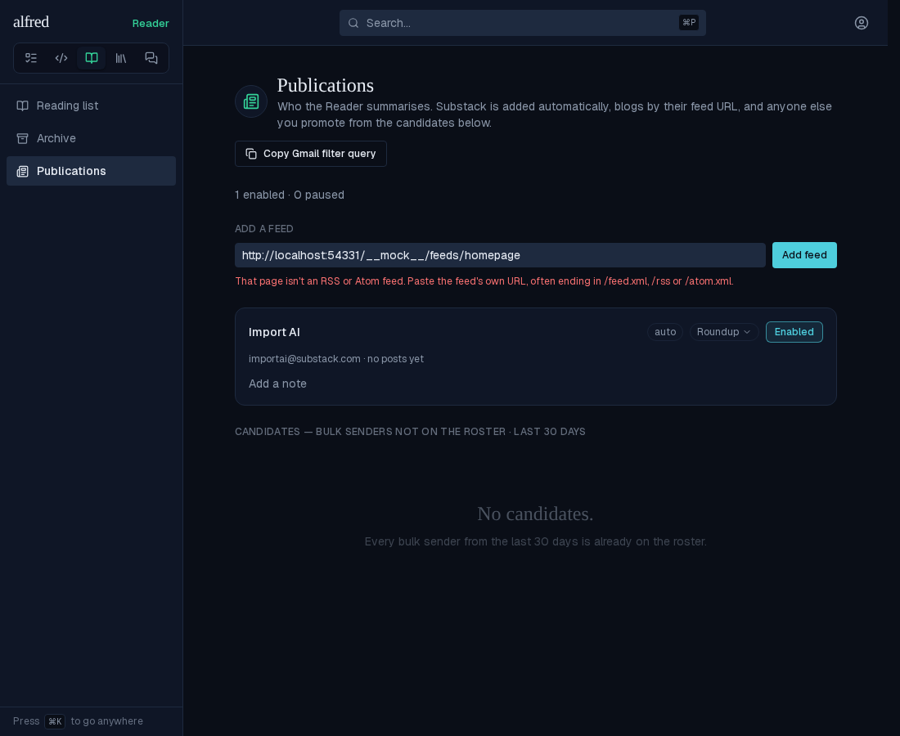
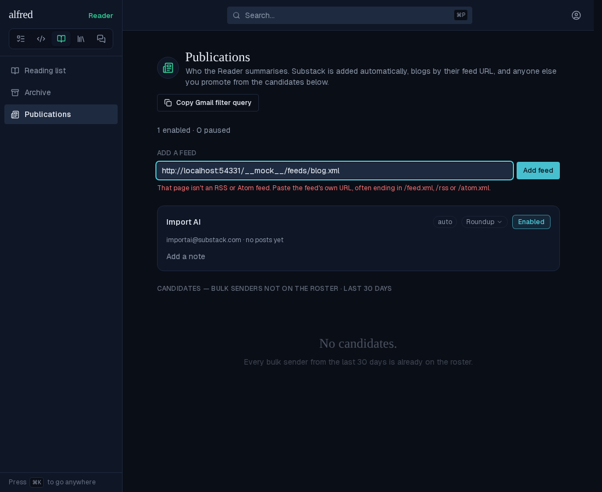
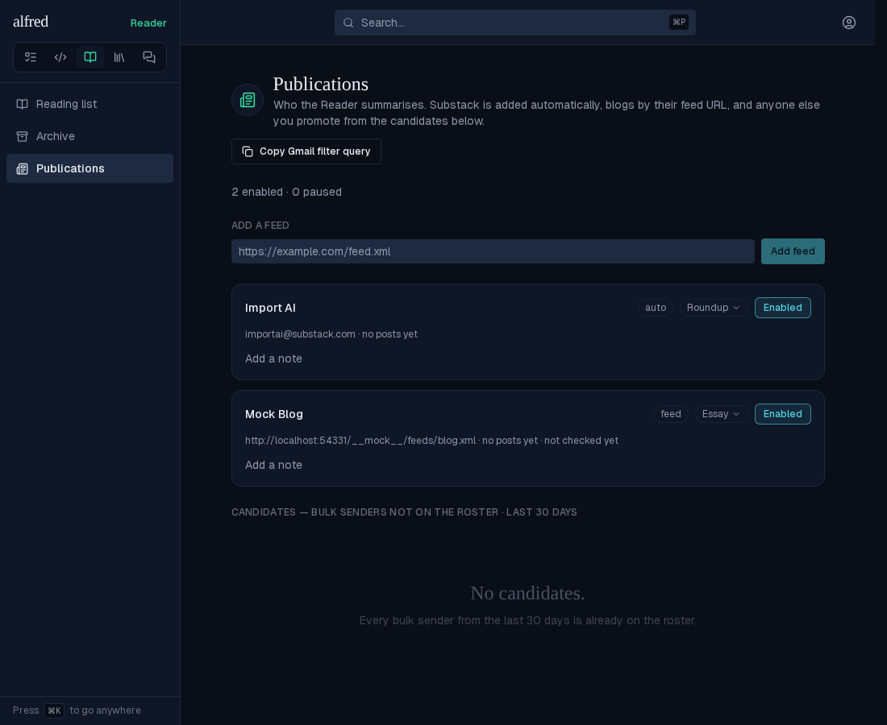
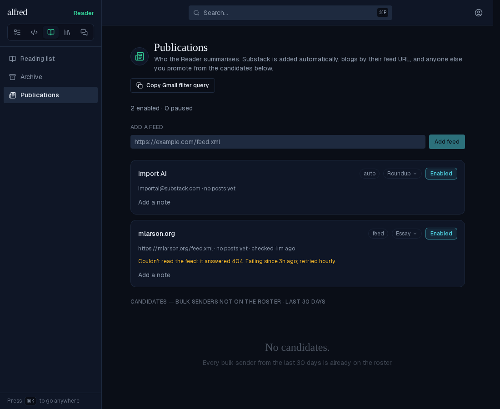
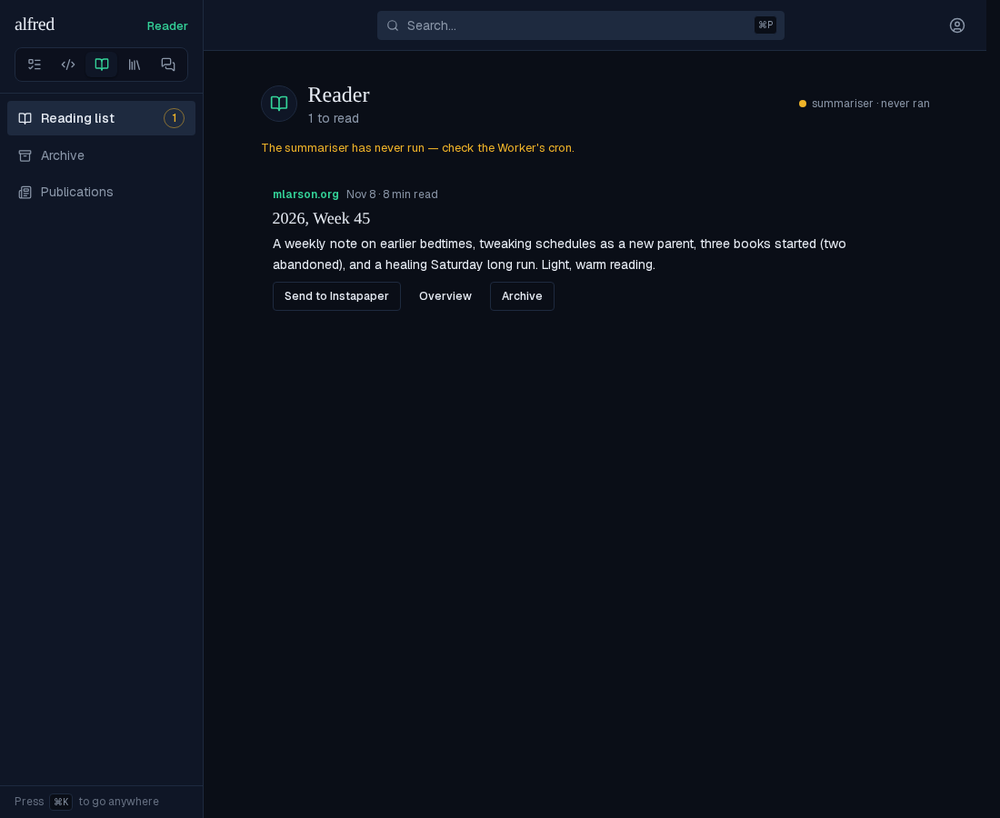
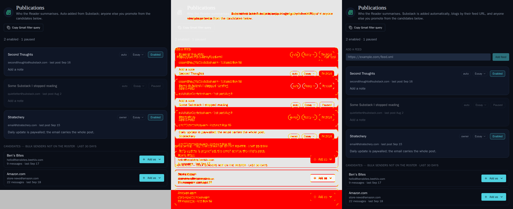

# Reader: import articles from RSS and Atom feeds (ALF-344)

*2026-11-09T16:48:11.205Z*

Paste a blog's feed URL on **/reader/publications** and it joins the roster as a card. The Worker's five-minute Reader tick then polls one due feed hourly and every new entry from the last seven days lands in the reading list, summarised with the feed's own summary kind like a newsletter.

**The parser on the real motivating feed.** `mlarson.org/feed.xml` turned out to be Atom 1.0 with full `content` and only an `updated` date. The script below runs the Worker's own parser and planner (`workers/src/reader/feeds.ts`) over the committed capture, as a poll on the capture day (2026-11-09). Only the entry inside the seven-day horizon is taken. None of the entries is an excerpt, so no entry page would be fetched. A re-poll once that post is stored takes nothing.

```bash
node docs/demos/reader-feeds/parse-mlarson.mjs
```

```output
feed: Mark Larson (author Mark Larson), 3 entries
- 2026, Week 45
    id https://mlarson.org/2026/11/08/2026-week-45/
    date 2026-11-08T08:11:17.000Z  excerpt? no — full content
- 2026, Week 44
    id https://mlarson.org/2026/11/01/2026-week-44/
    date 2026-11-01T11:11:26.000Z  excerpt? no — full content
- 2026, Week 43
    id https://mlarson.org/2026/10/25/2026-week-43/
    date 2026-10-25T08:10:41.000Z  excerpt? no — full content

poll at 2026-11-09T12:00:00.000Z, five slots free:
takes 2026, Week 45
drained: true (so the feed is stamped checked)
re-poll with that post stored takes: 0 entries
```

**Adding a feed: the live app** (Playwright against the in-memory Supabase mock, which serves a small Atom feed titled "Mock Blog" and an HTML homepage; the route's probe really fetches both from the Next server). First a homepage is pasted in. The route fetches it, finds no RSS or Atom root, and refuses it. The field keeps the text and says why on one line beneath it, and nothing is added.



Then the feed's own URL. Before pressing Enter:



After Enter, the card appears at its sorted place. It is named from the feed's title, wears a **feed** chip in place of the provenance, defaults to Essay and Enabled, and shows the feed URL and "not checked yet" where a sender shows its handle. The count line counts it; the field clears.



**A failing feed.** The Worker stamps a failed poll on the feed's own row. While the error is newer than the last success, the card shows the amber line, counted from the last success. The tick's own health, and the Reader header, are untouched.



**A feed post in the reading list.** It is an ordinary row: the eyebrow is the feed's card name (not the entry's author), the date is the entry's own publish date, and there is no "via" suffix.



**Moved Storybook baselines.** The Add-a-feed field sits above the roster on every publications story, and the heading's description changed, so six `Reader/PublicationsView` baselines moved (approved and committed). Below is the `Populated` diff: baseline | changed pixels | new. Four new baselines cover the feed states: `FeedAdded`, `NotAFeed`, `FeedFailing` and `Reader/PostRow` `FeedPost`.


