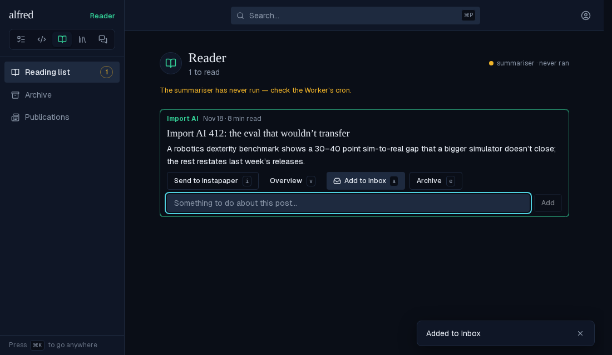
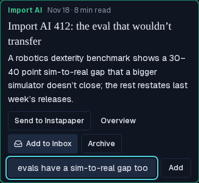
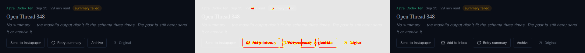
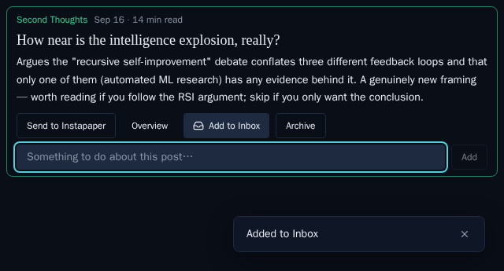

# Add an Inbox item from a Reader post

*2026-11-18T13:50:37.621Z*

Every reader row now has an **Add to Inbox** verb (key `a` on the selected row) that toggles a one-line field under the verb line. Whatever is typed lands in the Inbox as an unclassified capture: its title is the trimmed text, its `source_url` the row's Original (or Session) link, and its notes name the post. The post stays on the list. Captured live through the Playwright mock backend.

**1. Select the post and press `a`.** The field opens under the verbs, focused; the verb takes its pressed wash and shows its `a` keycap.

**2. Press Enter.** The field clears and keeps focus for the next item, the post stays put, and an "Added to Inbox" toast appears. Its text is a link to the Inbox.

**3. Click the toast.** It opens the Inbox list (`/?view=inbox`), where the item is already there with no reload: the typed title, and notes that read `From the Reader: “<post title>” — <eyebrow>` followed by the post's link.

**At phone width (375 px)** the verb line wraps the way it already did, and the input and Add button share one line, with the input shrinking.

**Storybook baselines.** Two new snapshot stories, `InboxCaptureOpen` and `InboxCaptureAdded`, pin the open and just-added states. The new verb moved every existing `PostRow` baseline, and the reading-list and archive baselines that draw rows; all were regenerated through the snapshot gate. Three moved by more than the 1% gate threshold. Their diffs (baseline | changed pixels | new) follow; the rest moved by less and were removed and rewritten so they wouldn't stay stale.

The two new baselines, open and just added:

