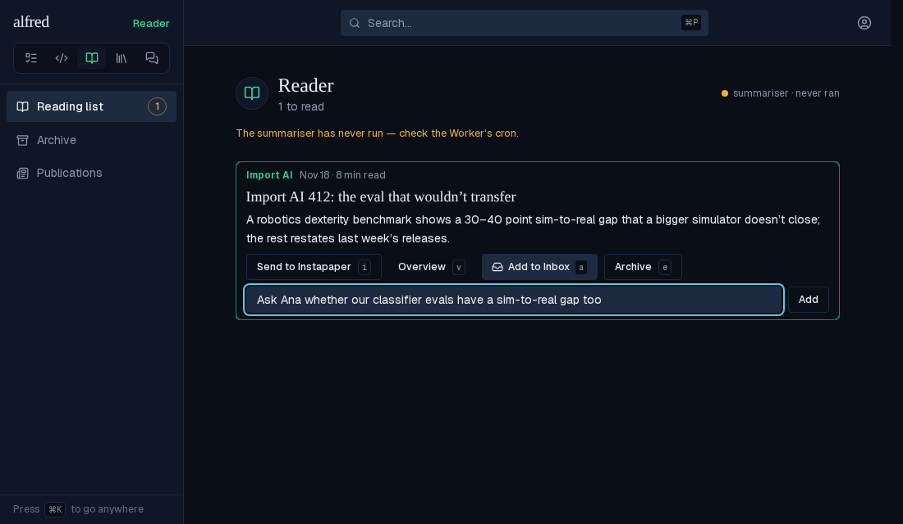
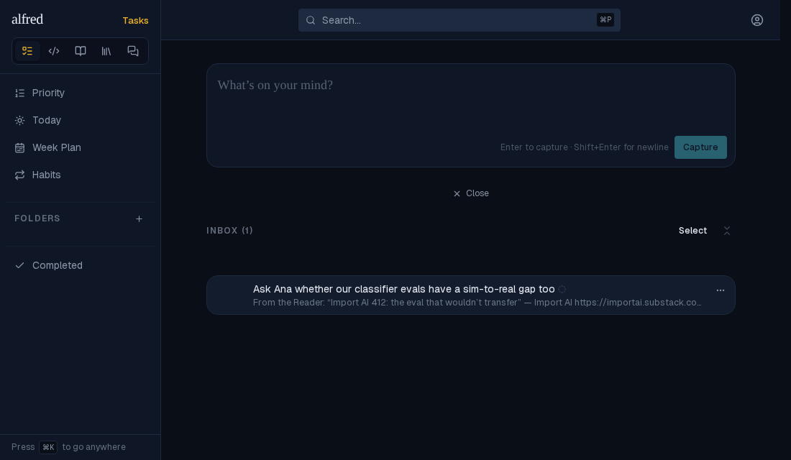
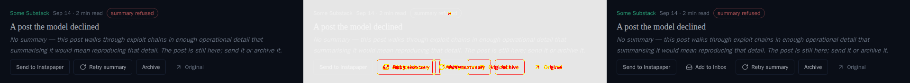
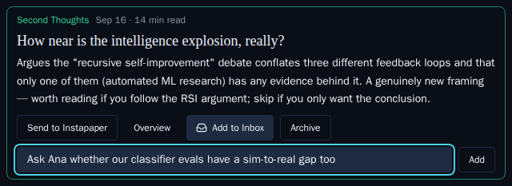
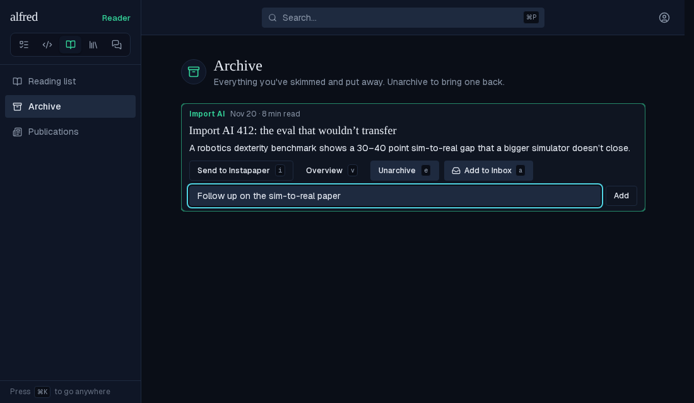

# Add an Inbox item from a Reader post

*2026-11-18T13:50:37.621Z*

Every reader row now has an **Add to Inbox** verb (key `a` on the selected row) that toggles a one-line field under the verb line. Whatever is typed lands in the Inbox as an unclassified capture: its title is the trimmed text, its `source_url` the row's Original (or Session) link, and its notes name the post. The post stays on the list. Captured live through the Playwright mock backend.

**1. Select the post and press `a`.** The field opens under the verbs, focused; the verb takes its pressed wash and shows its `a` keycap. It sits after Archive and before Original.

**2. Press Enter.** The field clears and keeps focus for the next item, the post stays put, and an "Added to Inbox" toast appears. Its text is a link to the Inbox.

**3. Click the toast.** It opens the Inbox list (`/?view=inbox`), where the item is already there with no reload: the typed title, and notes that read `From the Reader: “<post title>” — <eyebrow>` followed by the post's link.

**At phone width (375 px)** Send, Overview and Archive keep their one line, and Add to Inbox is the verb that wraps to a second line. The input and the Add button share one line, with the input shrinking.

**Storybook baselines.** Two new snapshot stories, `InboxCaptureOpen` and `InboxCaptureAdded`, pin the open and just-added states. The new verb also changes every existing `PostRow` baseline, plus the reading-list and archive baselines that draw rows. Because it's appended at the end of the verb line, each one moves by less than the gate's 1% threshold, so the gate writes no diff images. Those baselines were deleted and rewritten through the snapshot gate so they wouldn't stay stale. Before (`main`) and after for the failed row:

The two new baselines, open and just added:

**A failed add.** With `POST /api/items` answering 500, the store rolls back and shows its own "Couldn't add task" toast. The field gets the typed text back, and no "Added to Inbox" toast appears.

**In the archive.** The same verb and field sit beside Unarchive.

Covered by tests only, since they have no distinct screen: Escape or a second click on the verb closes the field and discards the draft (focus returns to the verb, and the row stays selected). A post with no link sends no `source_url` and gets a one-line note.
