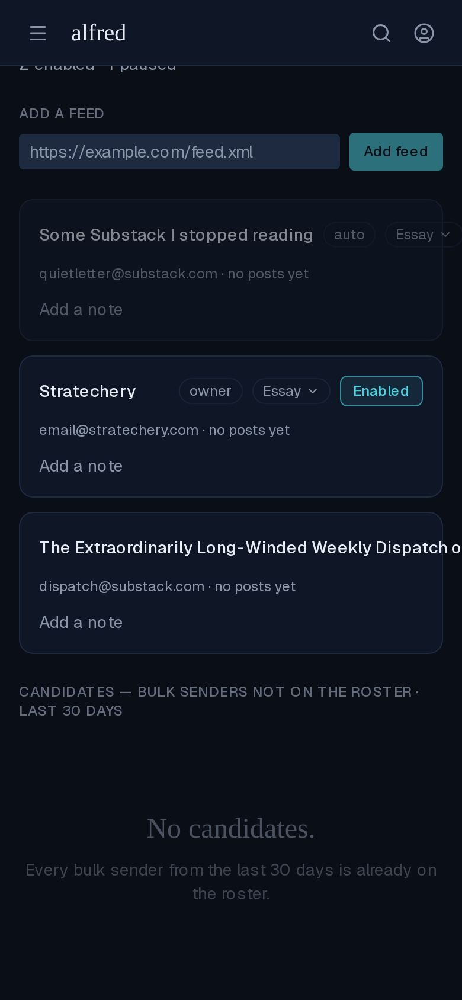

# Publication card controls wrap below a long name on a phone (ALF-350)

*2026-11-20T03:13:29.850Z*

A publication card's title row is the name, provenance chip, kind chip and pause toggle. On a 390×844 phone viewport, a long name used to push the kind chip and the toggle past the card's right edge and off-screen: the row could neither wrap nor shrink, because the name's `EditableTextField` display button had no `min-w-0`.

**Before** — the paused card's kind chip is cut off and its Paused toggle is unreachable; the third card's controls are entirely off-screen:

**After** — when the name can't share the line, the three controls drop to a second row together, right-aligned as on desktop, and the name stays whole. A name wider than the card wraps across lines. A short name (Stratechery) keeps everything on one row, unchanged:

