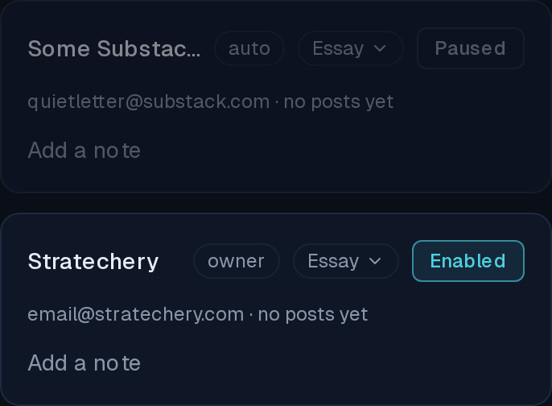

# Publication card title row fits a phone width (ALF-350)

*2026-11-20T02:51:50.583Z*

At a 390px phone width, a publication card's title row (name · provenance chip · kind chip · pause toggle) is one non-wrapping flex line. The name lives in `EditableTextField`'s display button — a `flex-1` flex item with no `min-w-0`, so its minimum width was its content's and the name's `truncate` never engaged. A long name therefore shoved the kind chip and the pause toggle past the card's right edge (and off-screen).

**Before** — the paused card's kind chip is cut off and its Paused toggle is unreachable:

**After** — `min-w-0` on the display button lets the name shrink and ellipsize; every control stays on the card. Short names (Stratechery) are unchanged:

